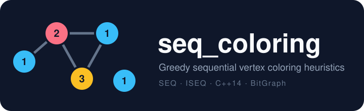

<p align="center">
  
</p>

<p align="center">
  
  
  
</p>

# Greedy sequential vertex coloring heuristics

Header-only C++ implementations of two greedy vertex coloring heuristics for undirected graphs, built on the bitset-based [BitGraph](https://github.com/psanse/BitGraph) library:

| Class | Heuristic | Idea |
|---|---|---|
| `GreedySequentialColoring` | **SEQ** | Takes the vertices in a predefined order and gives each one the smallest **available color**, i.e. the smallest color not used by its already-colored neighbors. |
| `GreedyIsetSequentialColoring` | **ISEQ** | Variant of SEQ that builds one independent (color) set at a time. Needs only two bitsets, and it is the upper bound used in state-of-the-art maximum clique algorithms such as CliSAT ([*CliSAT: A new exact algorithm for hard maximum clique problems*, 2023](https://www.sciencedirect.com/science/article/pii/S0377221722008165)). |

Both heuristics can color the whole graph or just the subgraph induced by a given set of vertices. Colors are numbered from 1.

## Usage

Include [`src/seq_coloring.h`](src/seq_coloring.h) and color a graph:

```cpp
#include "seq_coloring.h"

bitgraph::ugraph ug{ 5 };
ug.add_edge(0, 1);
ug.add_edge(1, 2);
ug.add_edge(2, 3);
ug.add_edge(1, 3);

// SEQ: color the subgraph induced by vertices {1, 2, 4}
std::vector<int> subgraph = { 1, 2, 4 };
GreedySequentialColoring seq{ ug, static_cast<int>(subgraph.size()) };  // upper bound on #colors
int n_colors = seq.run(&subgraph);        // 2
int c = seq.color(2);                     // 2

// ISEQ: color the full graph
GreedyIsetSequentialColoring iseq{ ug };
n_colors = iseq.run();                    // 3
```

See [`src/main_seq.cpp`](src/main_seq.cpp) and [`src/tests/test_seq_coloring.cpp`](src/tests/test_seq_coloring.cpp) for complete examples.

## Build

BitGraph and GoogleTest are fetched automatically by CMake (`FetchContent`), so you only need a C++14 compiler and CMake 3.14 or later.

```bash
cmake -S . -B build
cmake --build build --config Release
ctest --test-dir build -C Release -R SeqColorTest      # run this project's unit tests
```

The demo executable `sequential_coloring` is written to `bin/`.

## Project layout

```
src/seq_coloring.h     SEQ and ISEQ heuristics (header-only)
src/main_seq.cpp       demo executable
src/tests/             GoogleTest unit tests
docs/logo.svg          project logo
```

## Author

[Pablo San Segundo](https://github.com/psanse)
